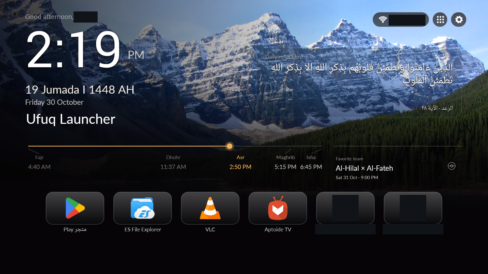
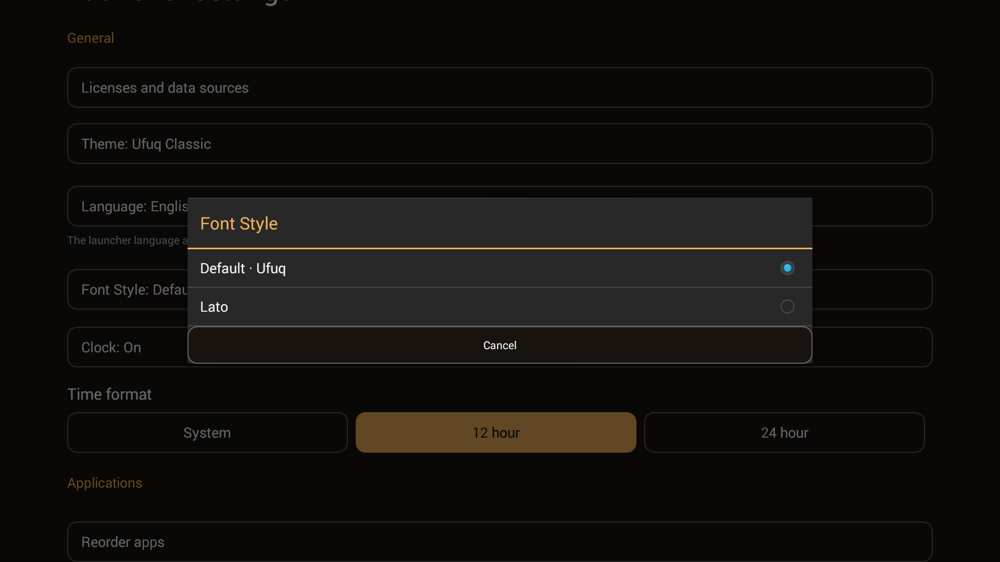
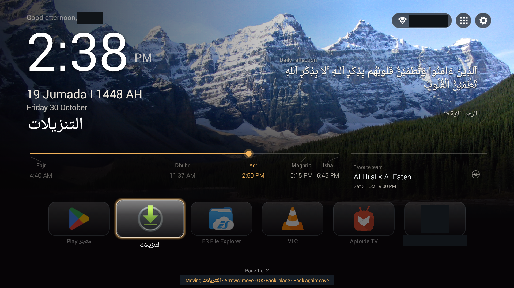

# Ufuq Launcher

[العربية](README_AR.md) · [English gallery](docs/gallery/GALLERY_EN.md) · [معرض الصور العربي](docs/gallery/GALLERY_AR.md)

A cinematic, remote-friendly Android TV launcher built with native Java and Android Views. Ufuq brings a prominent clock, daily reflections, prayer times, football fixtures and your favorite apps into one coherent Home screen.

**1.0.0-rc2 · release candidate · public publication pending.** The independently signed candidate has been tested on the owner's Nobel Android 4.4.4 television. No official public APK release has been published yet.



*Real TV capture, full 16:9 frame. The actual greeting, dates, horizon, controls and complete dock retain their positions. Only the personal name, SSID text and two private app entries are masked. No demo name, icon or UI was invented. [Image provenance and credits](docs/gallery/CREDITS.md).*

## Three themes, one Ufuq experience

| Classic | Midnight | Coast |
|---|---|---|
|  |  |  |
| Cinematic gold | Dark silver | Blue/turquoise accents |

Themes share geometry, navigation and functionality. Wallpaper selection, rotation and dimming remain independent of the palette. Five audited scenes are bundled: two public-domain landscape photographs and three original MIT landscapes.

## Features

| Everyday use | What Ufuq offers |
|---|---|
| Home | Large clock; actual morning/evening greeting with an optional locally saved name; independent Gregorian/Hijri visibility and Hijri adjustment |
| Favorites | Recognizable app icons, Small/Medium/Large tiles, whole-card pages, long-OK menu, move/place/save and persistent ordering |
| Apps | Native application library; add/remove Home shortcuts without uninstalling apps |
| Daily Reflection | Offline Quran/Hadith selection, dynamic preview, full-entry reading, source links and attribution |
| Prayer horizon | Five-prayer timeline, next-prayer information and marker; offline calculations for five Saudi cities using UTC+03:00 |
| Football | Favorite-team selection, text fixtures, device-local match times, immediate team-scoped cache and asynchronous refresh |
| Personalization | Classic/Midnight/Coast, independent language-specific fonts, fixed/random wallpapers, dimming and rotation frequency |
| Device controls | Guarded native Wi-Fi/system fallback, capability-based Inputs and user-initiated opening of another launcher |

The full [English gallery](docs/gallery/GALLERY_EN.md) covers all 14 feature groups, with honest labels where a current screen was captured only in Arabic. Those images are not relabeled as English UI. The [feature comparison](docs/FEATURE-PARITY.md) and [final audit](docs/FINAL-PRODUCT-AUDIT.md) distinguish source checks, framework tests, injected keys and owner-reported physical-remote results.

Optional clock/screensaver and explicitly user-enabled remote helpers remain available where supported; accessibility is never enabled automatically. Third-party app labels may follow the installed app/system language, and canonical religious text remains Arabic inside English UI.

## Make it yours

- **Arabic RTL / English LTR:** language, direction and saved font choice follow the UI language.
- **Arabic fonts:** Default, Cairo, Tajawal, IBM Plex Sans Arabic, Readex Pro and Almarai. **English fonts:** Default or Lato. Preferences are independent; clock/religious typography remains purpose-specific.
- **Wallpapers:** choose a fixed scene or timed random rotation, keep the previous fixed selection, and adjust dimming. Rotation frequency is disabled in Fixed mode without losing the saved interval.
- **Favorites and information:** choose tile size, reorder across whole-card pages, customize the greeting, and independently show calendars, prayers, reflections and football. Ordinary cinematic settings update in place; language changes use a controlled recreation.

| English font choices | Favorite movement |
|---|---|
|  |  |

## Android compatibility

Designed for **Android 4.4 / API 19 and newer**, with native Views, D-pad navigation and restrained memory use. Installation success is not compatibility certification.

| Environment | Evidence and limitation |
|---|---|
| Nobel/CVTE Android 4.4.4, API 19,1920×1080 | Actual TV captures and owner-reported Arabic/English physical-remote flow; tested device only |
| API 19/28/34 | Framework regression tests, not emulator or hardware certification |
| Other Android TV / Google TV hardware, API 35+ | Not physically verified |
| Wi-Fi | Native legacy panel on19–28 with applicable user permission; system settings on29+; unsupported security routes to system configuration |
| Inputs / HOME | Require supported platform handlers/firmware; API 19 lacks standard TIF. No automatic default-HOME change |

See [COMPATIBILITY](COMPATIBILITY.md) for TLS/trust-store, permissions, display/overscan, feature detection and untested scenarios. Prayer cities are currently Saudi cities; broader locations are not implied.

## Install safely

There is no official public APK download yet. For an owner-approved signed candidate or future release:

1. Verify its SHA-256, independent certificate and package `io.github.mansouralotaibi.ufuq`.
2. Open it with Android's normal package installer and review the device's installation consent.
3. Launch Ufuq from the app list. Keep the current HOME unless you explicitly choose another later.

Do not disable, clear or uninstall another launcher, grant privileged permissions, or run inherited installation scripts. CI APKs are **unsigned validation artifacts**, not official signed releases. See [INSTALLATION](INSTALLATION.md) and [candidate identity/checksum](docs/SHA256SUMS-SIGNED.txt).

## Build from source

Use JDK 17, Android platform/build-tools 34 and the supplied Gradle 8.9 wrapper. Repository access is required while it remains private.

```sh
git clone https://github.com/MansourAlotaibi/ufuq-launcher.git
cd ufuq-launcher/launcher
./gradlew --no-daemon testReleaseUnitTest lintRelease assembleRelease
```

The default build is unsigned. Follow [BUILDING](BUILDING.md) for reproducible tool configuration, public-only signing and accompanying dependency source. Never reuse a personal MansourTV signing key or commit credentials. [Backup/recovery status](docs/SIGNING-RECOVERY.md): the owner completed the encrypted local backup and separate-copy signing recovery test, including API 19 v1/v2 verification. Independent off-device disaster-recovery custody remains outstanding.

The accepted application source at `7091b90` passed [GitHub CI](https://github.com/MansourAlotaibi/ufuq-launcher/actions/runs/41077946236):355 tests, 0 failures and release lint 0 errors / 149 warnings, plus release build and security/license-policy checks. This gallery is a local documentation update, not a new hardware test or a new CI run.

## Privacy and security

No telemetry, analytics, WebView or Compose UI is added. Greetings, favorites, fonts and wallpaper choices are local; football uses optional foreground-driven networking and a private local cache. Legacy Wi-Fi passes user-entered credentials to Android; modern connection management uses system settings. Ufuq's independent identity cannot update the protected personal package.

[PRIVACY](PRIVACY.md) explains permissions, storage, cache and networking. [SECURITY](SECURITY.md) explains private vulnerability reporting and its publication gate. Never post secrets, SSIDs or raw device dumps in public issues. The gallery contains only curated privacy-redacted derivatives; raw device captures remain excluded.

## Open-source code and content rights

Code is MIT, derived from CleanYourTV with upstream notices preserved. Content, fonts, provider data and visible third-party app marks retain their separate rights; they are not blanket MIT assets.

- **Quran:** four complete Arabic verses from official Tanzil Uthmani 1.1, CC BY 3.0 with source-specific verbatim/notice conditions. No translation or altered wording is bundled.
- **Hadith:** three revision-pinned Arabic Wikisource Sahih al-Bukhari matn excerpts, CC BY-SA 4.0, with source/history attribution. This is a curated reflection corpus, not complete Quran/Hadith books.
- **Football:** TheSportsDB text-only integration with provider attribution. The documented public test identifier is not a private credential. Terms distinguish app-store publication, which requires a paid subscription; GitHub hosting/Releases are not automatically equated with an app store or treated as unrestricted production permission. Respect provider/third-party rights and recheck the intended channel. No logos/provider artwork are downloaded.
- **Fonts and wallpaper:** official static SIL OFL 1.1 fonts; provenance-verified public-domain photographs and original MIT landscapes. Use only additional images whose rights permit the intended use.
- **Screenshots:** actual full 1920×1080 frames with documented privacy masks; no composited demo apps or fictional greeting. App icons identify actual installed public applications, not endorsement or reusable icon assets. Complete screenshot/component credits are in [CREDITS](docs/gallery/CREDITS.md).

See [LICENSE](LICENSE), [THIRD-PARTY-NOTICES](THIRD-PARTY-NOTICES.md), [asset inventory](third_party/public-assets.json) and [image provenance](docs/gallery/PROVENANCE.json). A disclaimer is not permission to distribute restricted material.

## Contribute

Read [CONTRIBUTING](CONTRIBUTING.md) and [CODE_OF_CONDUCT](CODE_OF_CONDUCT.md). Include Android version, device model, language/theme and safe reproduction steps; redact personal data. Preserve API 19, native Views, D-pad behavior, RTL/LTR, independent package/signing and safe HOME behavior. Useful contributions include compatibility evidence, focused fixes, localization and properly licensed content.
