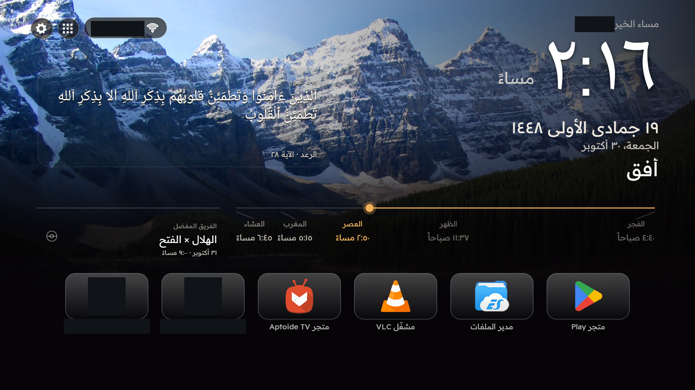
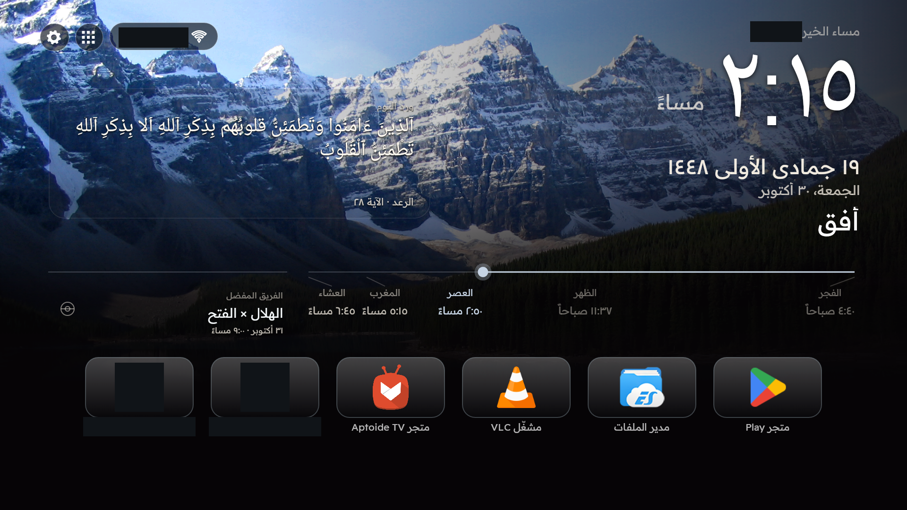
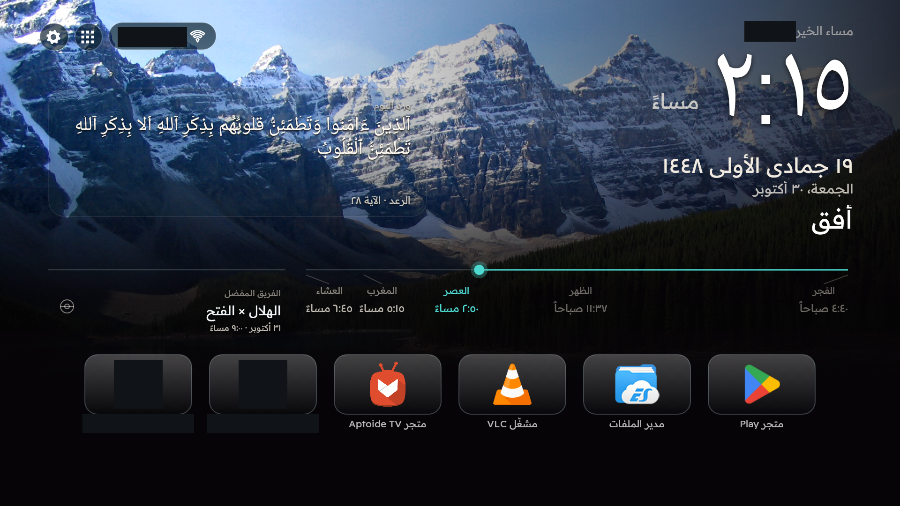
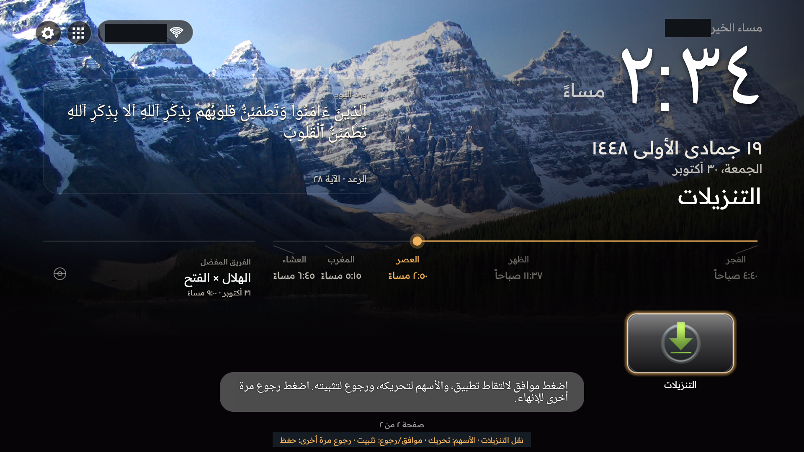

<div dir="rtl">

# مشغّل أفق

[English](README.md) · [معرض الصور العربي](docs/gallery/GALLERY_AR.md) · [English gallery](docs/gallery/GALLERY_EN.md)

مشغّل سينمائي لتلفزيونات أندرويد، مصمم للاستخدام بالريموت ومبني بلغة Java وواجهات أندرويد الأصلية. يجمع أفق الساعة البارزة والورد اليومي ومواقيت الصلاة والمباريات والتطبيقات المفضلة في صفحة رئيسية متناسقة.

**الإصدار المرشح 1.0.0-rc2 — النشر العام قيد التحضير.** اختُبرت النسخة الموقّعة بهوية مستقلة على تلفزيون المالك Nobel بنظام Android 4.4.4. لم يُنشر ملف APK رسمي للعامة بعد.



*لقطة فعلية من التلفزيون بنسبة 16:9 كاملة، مع إبقاء التحية والتواريخ وخط الأفق والأزرار وشريط المفضلة في مواضعها الأصلية. حُجب الاسم الشخصي ونص اسم الشبكة وتطبيقان خاصان فقط. لم يُركّب اسم تجريبي أو أيقونة أو واجهة مصطنعة. راجع [توثيق الصور وحقوقها](docs/gallery/CREDITS.md).*

## ثلاث سمات وتجربة أفق واحدة

| الكلاسيكي | منتصف الليل | الساحل |
|---|---|---|
|  |  |  |
| ذهبي سينمائي | فضي داكن | لمسات زرقاء وتركوازية |

تشترك السمات في توزيع العناصر والتنقل والوظائف. اختيار الخلفية وتبديلها وتعتيمها مستقل عن ألوان السمة. تتضمن المجموعة خمسة مشاهد موثقة الحقوق: صورتين فوتوغرافيتين من الملكية العامة وثلاثة مناظر أصلية برخصة MIT.

## المزايا

| الاستخدام اليومي | ما يقدمه أفق |
|---|---|
| الرئيسية | ساعة كبيرة، وتحية صباحية أو مسائية مع اسم اختياري محفوظ محلياً، وإظهار مستقل للتاريخين الميلادي والهجري مع تعديل اليوم الهجري |
| المفضلة | أيقونات تطبيقات واضحة، وأحجام صغير ومتوسط وكبير، وصفحات ببطاقات كاملة، وقائمة بالضغط المطول على موافق، ونقل وتثبيت وحفظ الترتيب |
| التطبيقات | مكتبة أصلية لإضافة اختصارات الرئيسية وإزالتها دون إلغاء تثبيت التطبيقات |
| الورد اليومي | اختيار القرآن أو الحديث دون اتصال، ومعاينة ديناميكية، وقراءة النص كاملاً مع روابط المصدر والتوثيق |
| أفق الصلاة | خط زمني للصلوات الخمس ومعلومات الصلاة التالية والمؤشر، بحساب محلي لخمس مدن سعودية وفق UTC+03:00 |
| كرة القدم | اختيار الفريق المفضل، ومواعيد المباريات بتوقيت الجهاز، وعرض فوري للذاكرة المحلية الخاصة بالفريق مع تحديث غير متزامن |
| التخصيص | الكلاسيكي ومنتصف الليل والساحل، وخط مستقل لكل لغة، وخلفيات ثابتة أو عشوائية، وتعتيم وفترة تبديل |
| تحكم الجهاز | لوحة Wi-Fi الأصلية أو بديل إعدادات النظام، ومدخلات بحسب إمكانات الجهاز، وفتح مشغّل آخر باختيار المستخدم |

يغطي [المعرض العربي الكامل](docs/gallery/GALLERY_AR.md) مجموعات المزايا الأربع عشرة. يوضح [المعرض الإنجليزي](docs/gallery/GALLERY_EN.md) صراحةً الشاشات التي لا تتوفر لها لقطة حالية إلا بالعربية، ولا يعيد تسميتها كواجهة إنجليزية. تفصل [مقارنة المزايا](docs/FEATURE-PARITY.md) و[المراجعة النهائية](docs/FINAL-PRODUCT-AUDIT.md) بين مراجعة المصدر ومحاكاة الإطار والإدخال المحقون واختبار المالك بالريموت الفعلي.

تبقى خيارات الساعة وشاشة الخمول ومساعدات الريموت التي يفعّلها المستخدم صراحةً متاحة عند دعمها، دون تفعيل تلقائي لإمكانية الوصول. قد تتبع أسماء التطبيقات لغة التطبيق أو النظام، وتبقى النصوص الدينية الأصلية بالعربية داخل الواجهة الإنجليزية.

## خصّص تجربتك

- **العربية من اليمين والإنجليزية من اليسار:** تتبع اللغة واتجاه الواجهة واختيار الخط المحفوظ لغة الاستخدام.
- **الخطوط العربية:** الافتراضي و Cairo و Tajawal و IBM Plex Sans Arabic و Readex Pro و Almarai. **الإنجليزية:** الافتراضي أو Lato. يُحفظ اختيار كل لغة مستقلاً؛ وتبقى طباعة الساعة والنصوص الدينية مخصصة لغرضها.
- **الخلفيات:** اختر مشهداً ثابتاً أو تبديلًا عشوائياً مؤقتاً، واحتفظ بالاختيار الثابت السابق واضبط التعتيم. تتعطل فترة التبديل في الوضع الثابت دون فقد قيمتها المحفوظة.
- **المفضلة والمعلومات:** اختر حجم البطاقات ورتبها بين صفحات كاملة، وخصص التحية، وأظهر التقويمين والصلاة والورد والمباريات بصورة مستقلة. تُطبّق الإعدادات السينمائية المعتادة في مكانها؛ ويستخدم تغيير اللغة إعادة إنشاء مضبوطة للنشاط.

| خيارات الخط العربي | نقل التطبيقات المفضلة |
|---|---|
|  |  |

## التوافق مع أندرويد

صُمم لأندرويد 4.4 و API 19 فأحدث، مع واجهات أصلية وتنقل بالأسهم ومراعاة الذاكرة. نجاح التثبيت وحده لا يعني اعتماد توافق الجهاز.

| البيئة | الدليل والحدود |
|---|---|
| Nobel/CVTE بنظام Android 4.4.4 و API 19 ودقة 1920×1080 | صور تلفزيون فعلية وتأكيد المالك لسير الاستخدام بالريموت بالعربية والإنجليزية؛ يخص الجهاز المختبر |
| API 19 و 28 و 34 | اختبارات محاكاة إطار أندرويد، وليست اعتماداً لمحاكي أو جهاز فعلي |
| أجهزة Android TV و Google TV الأخرى و API 35 فأحدث | لم يُتحقق منها على أجهزة فعلية |
| Wi-Fi | لوحة أصلية على 19–28 مع صلاحية المستخدم عند لزومها؛ وإعدادات النظام على 29 فأحدث؛ وتُحال أنواع الأمان غير المدعومة إلى النظام |
| المدخلات والمشغّل الافتراضي | تعتمد على معالجات النظام والبرنامج الثابت؛ لا تتوفر واجهة TIF القياسية على API 19. لا يتغير المشغّل الافتراضي تلقائياً |

توضح [وثيقة التوافق](COMPATIBILITY.md) حدود TLS ومخزن الشهادات والصلاحيات وكثافة العرض والقص الخارجي واكتشاف الإمكانات والحالات غير المختبرة. المدن المدعومة لمواقيت الصلاة سعودية حالياً؛ ولا يُدّعى دعم مواقع أوسع.

## التثبيت الآمن

لا يوجد تنزيل APK رسمي للعامة بعد. عند استخدام نسخة موقّعة وافق عليها المالك أو إصدار مستقبلي:

1. تحقق من SHA-256 وشهادة التوقيع المستقلة والحزمة `io.github.mansouralotaibi.ufuq`.
2. افتح الملف بمثبّت الحزم المعتاد في أندرويد وراجع موافقة التثبيت على جهازك.
3. افتح أفق من قائمة التطبيقات، وأبقِ المشغّل الافتراضي الحالي ما لم تختر تغييره بنفسك لاحقاً.

لا تعطل مشغّلاً آخر ولا تمسح بياناته أو تلغِ تثبيته، ولا تمنح صلاحيات مميزة أو تستخدم سكربتات التثبيت الموروثة. ملفات CI **غير موقّعة ومخصصة للتحقق** وليست إصدارات رسمية موقّعة. راجع [التثبيت](INSTALLATION.md) و[هوية النسخة وبصمتها](docs/SHA256SUMS-SIGNED.txt).

## البناء من المصدر

استخدم JDK 17 ومنصة أندرويد وأدوات البناء 34 و Gradle 8.9 المرفق. يلزم إذن الوصول إلى المستودع ما دام خاصاً.

```sh
git clone https://github.com/MansourAlotaibi/ufuq-launcher.git
cd ufuq-launcher/launcher
./gradlew --no-daemon testReleaseUnitTest lintRelease assembleRelease
```

البناء الافتراضي غير موقّع. تتضمن [تعليمات البناء](BUILDING.md) إعداد الأدوات القابل للتكرار والتوقيع المستقل والمصدر المرافق للتبعيات. لا تستخدم مفتاح MansourTV الشخصي ولا تحفظ بيانات التوقيع في Git. [حالة النسخ الاحتياطي والاسترداد](docs/SIGNING-RECOVERY.md): أكّد المالك نجاح النسخة المحلية المشفّرة واختبار الاسترداد والتوقيع من نسخة منفصلة، بما يشمل التحقق من توقيعي v1 و v2 المتوافقين مع API 19. تبقى نسخة مستقلة خارج الجهاز والتحقق منها متطلباً قائماً للتعافي من فقد الجهاز.

اجتاز مصدر التطبيق المعتمد `7091b90` [اختبارات GitHub](https://github.com/MansourAlotaibi/ufuq-launcher/actions/runs/41077946236):355 اختباراً دون فشل، و lint دون أخطاء مع 149 تحذيراً، إضافة إلى بناء الإصدار وفحوص الأمان وسياسة التراخيص. هذا المعرض تحديث محلي للتوثيق، وليس اختبار جهاز أو تشغيل CI جديداً.

## الخصوصية والأمان

لا يضيف أفق تتبعاً أو تحليلات أو واجهات WebView أو Compose. تبقى التحية والمفضلة والخطوط والخلفيات محلياً، وتستخدم المباريات اتصالاً اختيارياً أثناء ظهور الواجهة وذاكرة محلية خاصة. تُمرّر بيانات Wi-Fi التي يدخلها المستخدم إلى أندرويد في الوضع القديم، وتُدار الاتصالات الحديثة عبر إعدادات النظام. الحزمة والتوقيع المستقلان لا يستبدلان التطبيق الشخصي المحمي.

تشرح [الخصوصية](PRIVACY.md) الصلاحيات والتخزين والذاكرة المحلية والشبكات، وتشرح [سياسة الأمان](SECURITY.md) الإبلاغ الخاص عن الثغرات وشرط تفعيله قبل النشر. لا تضع الأسرار أو أسماء الشبكات أو تفريغات الجهاز الخام في البلاغات العامة. يحتوي المعرض على نسخ منتقاة محجوبة الخصوصية فقط، وتظل الصور الخام مستبعدة.

## المصدر المفتوح وحقوق المحتوى

الكود برخصة MIT ومشتق من CleanYourTV مع الاحتفاظ بإشعاراته. للمحتوى والخطوط وبيانات المزود وعلامات التطبيقات الظاهرة حقوق مستقلة؛ ولا تصبح جميعها أصولاً برخصة MIT.

- **القرآن:** أربع آيات عربية كاملة من Tanzil Uthmani 1.1 وفق CC BY 3.0 وشروط النسخ الحرفي وحفظ الإشعار. لا توجد ترجمة أو صياغة معدلة للنص.
- **الحديث:** ثلاثة مقتطفات متن من صحيح البخاري موثقة بمراجعات محددة من ويكي مصدر العربية، وفق CC BY-SA 4.0 مع نسب المصدر وسجل المساهمين. إنها مجموعة منتقاة للورد، وليست مكتبة كاملة للقرآن وكتب الحديث.
- **كرة القدم:** تكامل نصي مع TheSportsDB وتوثيق للمزود. معرّف الاختبار العام الموثق ليس سراً خاصاً. تتطلب شروطه اشتراكاً مدفوعاً للنشر في متاجر التطبيقات؛ ولا تُعامل استضافة GitHub أو Releases تلقائياً كمتجر أو كإذن إنتاجي بلا قيود. احترم حقوق المزود والأطراف الأخرى وراجع قناة التوزيع المقصودة. لا تُنزّل شعارات الفرق أو صور المزود.
- **الخطوط والخلفيات:** ملفات رسمية ثابتة وفق SIL OFL 1.1 ، وصور موثقة من الملكية العامة ومناظر أصلية برخصة MIT. لا تضف صوراً دون حقوق تسمح باستخدامها وتوزيعها.
- **الصور الترويجية:** إطارات فعلية كاملة 1920×1080 مع توثيق أقنعة الخصوصية، دون تركيب تطبيقات تجريبية أو تحية وهمية. تُظهر الأيقونات تطبيقات عامة مثبتة فعلياً، ولا تعني تأييداً أو توفيرها كأصول قابلة لإعادة الاستخدام. راجع [حقوق الصور](docs/gallery/CREDITS.md).

راجع [الرخصة](LICENSE) و[إشعارات الأطراف الثالثة](THIRD-PARTY-NOTICES.md) و[سجل الأصول](third_party/public-assets.json) و[توثيق الصور](docs/gallery/PROVENANCE.json). التنبيه في README ليس إذناً لتوزيع مادة مقيّدة الحقوق.

## المساهمة

اقرأ [دليل المساهمة](CONTRIBUTING.md) و[مدونة السلوك](CODE_OF_CONDUCT.md). أرفق إصدار أندرويد وطراز الجهاز واللغة والسمة وخطوات آمنة لإعادة المشكلة، مع إخفاء البيانات الشخصية. حافظ على API 19 والواجهات الأصلية والتنقل بالريموت واتجاهي الكتابة والحزمة والتوقيع المستقلين وسلامة المشغّل الافتراضي. نرحب بأدلة التوافق والإصلاحات المحددة وتحسين الترجمة والمحتوى المرخص بصورة صحيحة.

</div>
