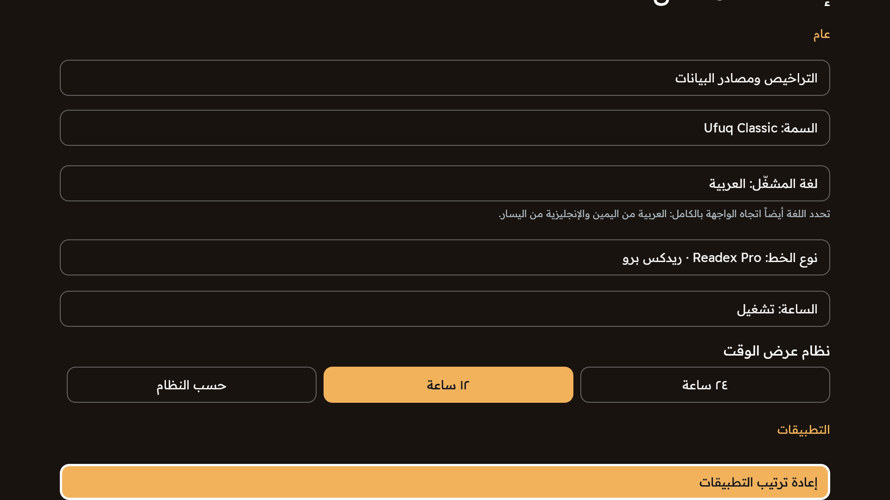

# معرض أفق — العربية

[English](GALLERY_EN.md) · [العربية](GALLERY_AR.md)

> صور تلفزيون فعلية 1920×1080 كاملة دون قص أو تغيير للنسب. المستطيلات الداكنة أقنعة خصوصية، وليست جزءاً من واجهة أفق. حُجبت الأسماء الشخصية والشبكات والتطبيقات الخاصة؛ وأُبقيت الأيقونات العامة والتحية الأصلية. لا توجد أسماء تجريبية مركبة أو واجهة مصطنعة. هذا عرض ترويجي مشتق من أدلة سابقة، وليس اختبار تشغيل جديداً.

[Credits / الحقوق](CREDITS.md) · [Provenance / التوثيق](PROVENANCE.json)

## السمات

ثلاث لوحات ألوان مع توزيع واحد للرئيسية الكاملة.

الرئيسية كاملة كما التُقطت: الساعة والتواريخ والورد والصلاة والمباريات وأزرار التنقل وشريط المفضلة. حُجب الاسم الخاص واسم الشبكة وتطبيقان خاصان، مع إبقاء أيقونات التطبيقات العامة. **لغة اللقطة: العربية.**

الرئيسية كاملة كما التُقطت: الساعة والتواريخ والورد والصلاة والمباريات وأزرار التنقل وشريط المفضلة. حُجب الاسم الخاص واسم الشبكة وتطبيقان خاصان، مع إبقاء أيقونات التطبيقات العامة. **لغة اللقطة: العربية.**

الرئيسية كاملة كما التُقطت: الساعة والتواريخ والورد والصلاة والمباريات وأزرار التنقل وشريط المفضلة. حُجب الاسم الخاص واسم الشبكة وتطبيقان خاصان، مع إبقاء أيقونات التطبيقات العامة. **لغة اللقطة: العربية.**

## الرئيسية والخلفيات السينمائية

صورة الغروب لقطة عربية فعلية؛ ولا يُدّعى توفر لقطة غروب إنجليزية.

مشهد الغروب الحقيقي مع التعتيم. الخلفية مستقلة عن السمة، ولا تغيّر أقنعة الخصوصية توزيع الواجهة. **لغة اللقطة: العربية.**

## التطبيقات المفضلة وحجم الشريط

أحجام صغير ومتوسط وكبير وصفحات البطاقات الكاملة إعدادات فعلية. تُبقي صور الرئيسية الشريط كاملاً، مع حجب الإدخالات الخاصة فقط.

الوضع الثابت والمشهد المختار والحجم الكبير للمفضلة وسطر التعتيم كما ظهرت فعلياً. سطر الفترة أسفل مجال العرض؛ فلا تثبت هذه اللقطة وحدها حالته المعطلة. **لغة اللقطة: العربية.**

## مكتبة التطبيقات ونقل المفضلة

لقطة الكتالوج الحالية بالعربية. ويتوفر وضع النقل بالعربية والإنجليزية. لم يُفتح تطبيق محمي لإعداد هذا المعرض.

كتالوج التطبيقات الحقيقي مع أيقونات التطبيقات العامة المعروفة. حُجبت خمسة إدخالات خاصة أو لأدوات حساسة؛ وليست المساحات المحجوبة خانات فارغة. **لغة اللقطة: العربية.**

حالة النقل الفعلية في الصفحة الثانية، مع تعليمات الأسهم وموافق ورجوع. التطبيق المحدد هو التنزيلات، وقد حُجبت البيانات الخاصة في الخلفية. **لغة اللقطة: العربية.**

## القرآن والحديث والقراءة الكاملة

لقطات القراءة الكاملة بالعربية. يبقى النص القرآني والحديثي بالعربية في لغتي الواجهة، دون إنشاء ترجمة أو نافذة إنجليزية وهمية.

نافذة القراءة الكاملة الفعلية مع المصدر وروابط الترخيص. لم يتغير النص القرآني أو تشكيله، وحُجبت البيانات الخاصة في الخلفية. **لغة اللقطة: العربية.**

قراءة فعلية لمقتطف الحديث مع المصدر وترخيص المشاركة بالمثل. بقي النص والتوثيق ظاهرين، ولم تُنشأ ترجمة حديثة. **لغة اللقطة: العربية.**

## خط الصلوات الخمس

يظهر في صور الرئيسية: مواضع متناسبة للصلوات والصلاة التالية والمؤشر. تتبع الحسابات المدينة السعودية المختارة وفق UTC+03:00 دون تغيير توقيت الجهاز.

## التاريخان الهجري والميلادي

يظهر التاريخان في صور الرئيسية؛ ويمكن التحكم في إظهار كل منهما بصورة مستقلة وتعديل اليوم الهجري.

## المباريات واختيار الفريق

تعرض الرئيسية مباريات كما ظهرت عند الالتقاط. نافذة اختيار المجموعة عربية، وقد حُجب الاسم الشخصي في الخلفية. ليست اللقطات ضماناً لنتائج حالية.

قائمة فعلية للأندية السعودية والعالمية، مع حجب الاسم الشخصي في الخلفية. بيانات المباراة لقطة وقت الالتقاط، وليست ادعاءً بنتيجة مباشرة حالية. **لغة اللقطة: العربية.**

## التحية الشخصية

تبقى كلمات التحية الحقيقية في الرئيسية، ويُحجب الاسم المحفوظ الخاص فقط. لم يُركّب اسم تجريبي، وتظل ميزة تخصيص الاسم موجودة.

## الخطوط الخاصة بكل لغة

نافذتا الخط العربـي والإنجليزي الفعليتان. تُحفظ الخيارات بصورة مستقلة مع افتراضي معتمد لكل لغة، ومعالجة مخصصة لطباعة الساعة والنصوص الدينية.

الافتراضي مع Cairo و Tajawal و IBM Plex Sans Arabic و Readex Pro و Almarai. هذه الخيارات الفعلية الخاصة باللغة العربية. **لغة اللقطة: العربية.**

خيارات الإنجليزية الفعلية: الافتراضي و Lato ، مع حفظ مستقل لاختيارات الخط في اللغتين. **لغة اللقطة: الإنجليزية — لقطة بلغة أخرى موضّحة، لا ترجمة مصطنعة للصورة.**

## الثابت والعشوائي والتعتيم والفترة

لقطات الإعدادات الحالية عربية. لا تنطبق فترة التبديل على الوضع الثابت وتُحفظ للعشوائي، ولا تثبت الصور وحدها حدوث التبديل بمرور الوقت.

الوضع الثابت والمشهد المختار والحجم الكبير للمفضلة وسطر التعتيم كما ظهرت فعلياً. سطر الفترة أسفل مجال العرض؛ فلا تثبت هذه اللقطة وحدها حالته المعطلة. **لغة اللقطة: العربية.**

الوضع العشوائي الفعلي مع تعطيل اختيار الصورة الثابتة بصرياً. الفترة المحفوظة ١٥ دقيقة، ولا تثبت هذه الصورة وحدها حدوث التبديل بمرور الوقت. **لغة اللقطة: العربية.**

## لوحة Wi-Fi

تُستخدم لقطة اللوحة الأصلية العربية الحالية فقط، مع حجب أسماء الشبكات. لم يُنفذ اتصال أو إدخال كلمة مرور. تستخدم API 29 فأحدث إعدادات النظام.

لوحة الشبكة الفعلية على API 19. حُجبت جميع أسماء الشبكات الظاهرة وسطر الشبكة المتصلة، مع إبقاء مؤشرات الإشارة والأمان. لم يتغير الاتصال؛ وتستخدم API 29 فأحدث إعدادات النظام. **لغة اللقطة: العربية.**

## التنقل الآمن بين المشغّلات

فُتحت القائمة العربية ثم أُغلقت، مع حجب أسماء المشغّلات الخاصة. هذه صورة لواجهة الاختيار وليست إثباتاً لتنفيذ تبديل. لم يتغير المشغّل الافتراضي أو أي مشغّل محمي.

قائمة فعلية أُغلقت دون فتح أي مشغّل محمي. حُجبت أسماء المشغّلات كلها. الصورة ليست دليلاً على تنفيذ تبديل أو تغيير المشغّل الافتراضي. **لغة اللقطة: العربية.**

## الإعدادات والتخصيص

إعدادات فعلية في كل لغة، دون إنشاء واجهة أو مسار تنقل أو ميزة تطبيق جديدة للحصول على الصور.

الإعدادات العربية الأصلية كما التُقطت، دون إنشاء واجهة أو خطوات بدء جديدة للترويج. **لغة اللقطة: العربية.**
