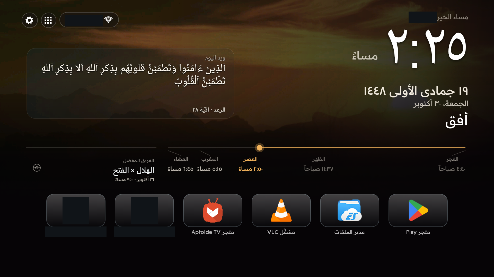
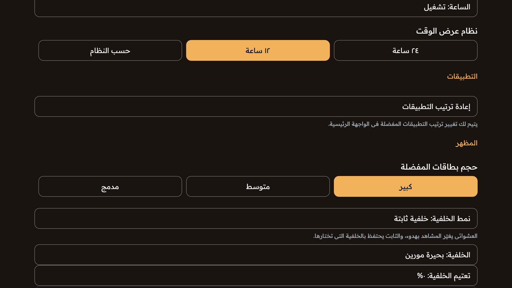
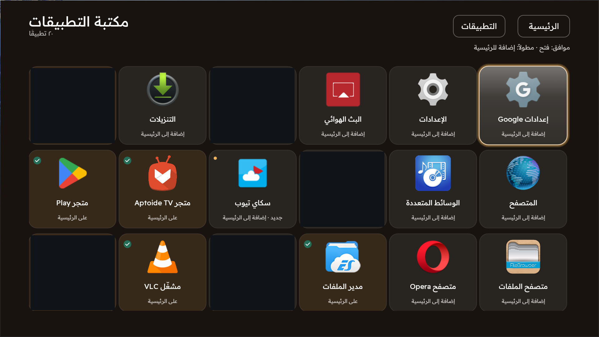
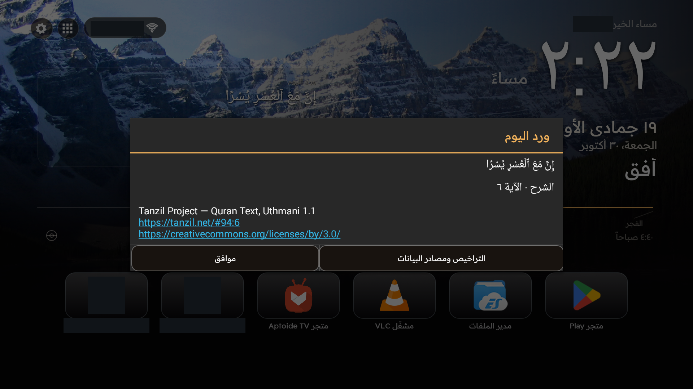
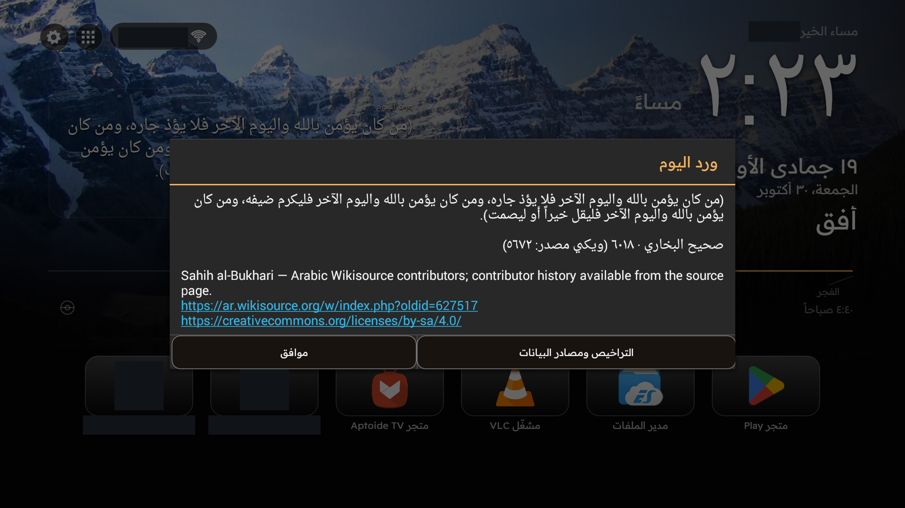
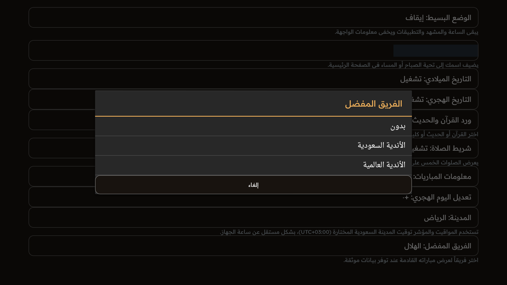
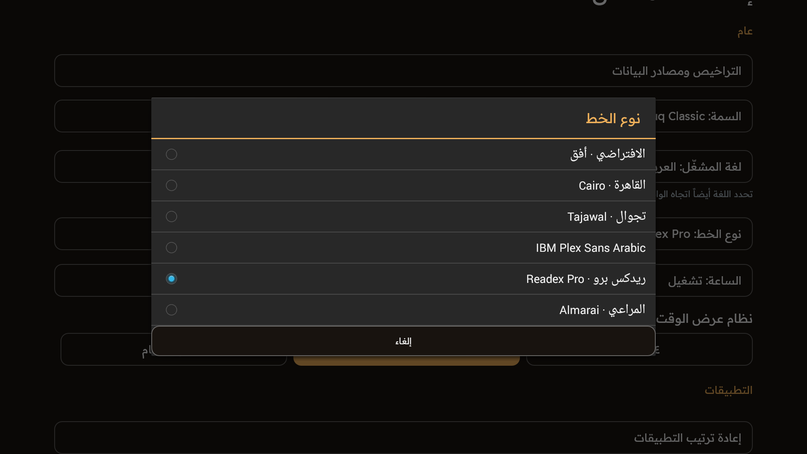
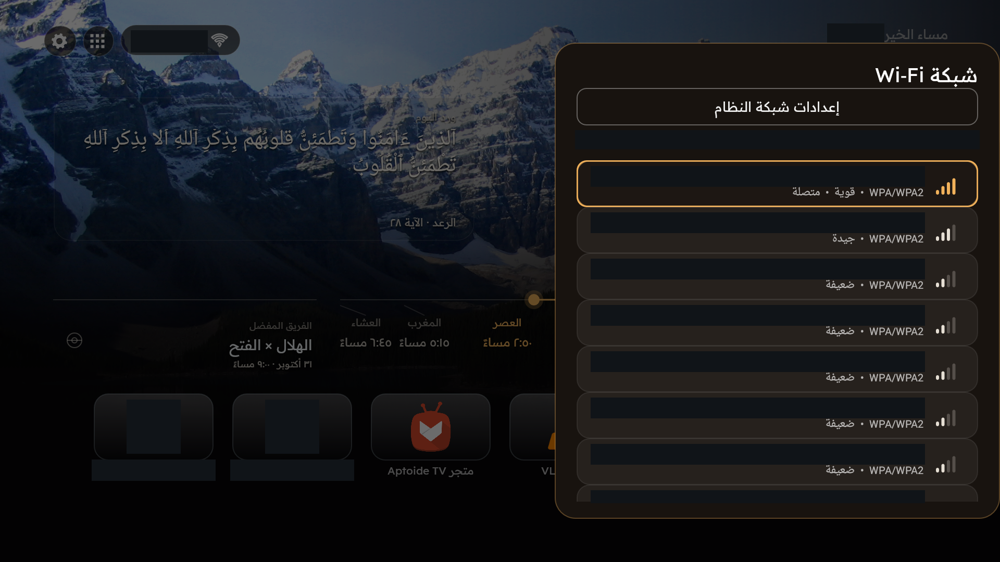
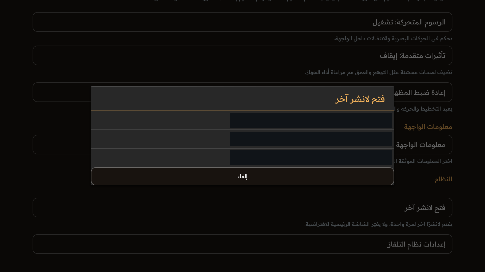
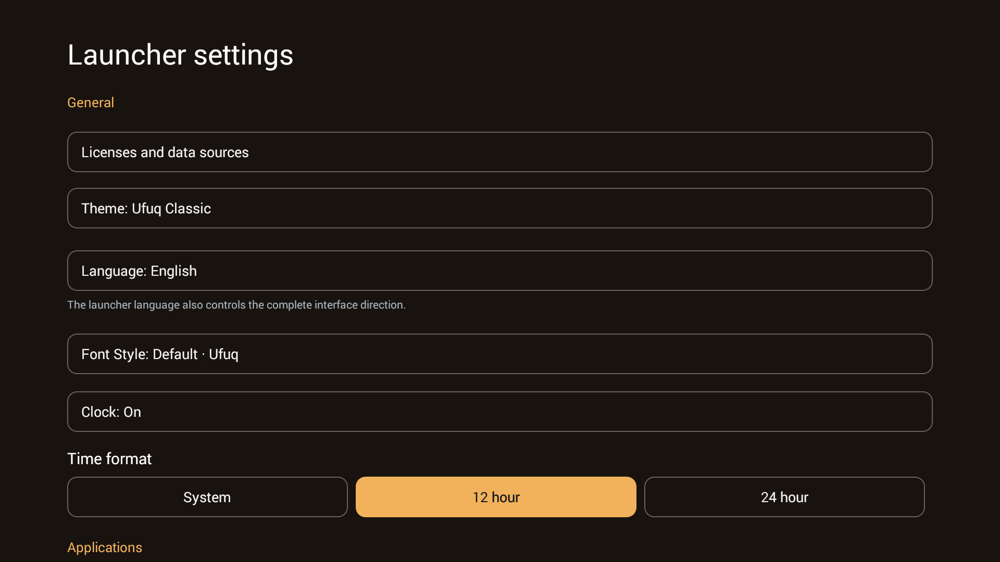

# Ufuq — English gallery

[English](GALLERY_EN.md) · [العربية](GALLERY_AR.md)

> Actual full 1920×1080 TV frames, uncropped and proportionally unchanged. Dark rectangles are privacy masks, not Ufuq UI. Personal names, network labels and private entries are hidden; common icons and the real salutation remain. No fictional demo names or synthesized interface. These are promotional derivatives of earlier evidence, not new runtime tests.

[Credits / الحقوق](CREDITS.md) · [Provenance / التوثيق](PROVENANCE.json)

## Themes

Three palettes, the same full Home geometry.

Actual full Home. Clock, dates, reflection, prayer/football horizon, navigation and the complete dock remain in place. Private name/SSID and two private app entries masked; common app icons retained. **Screenshot UI: English.**

Actual full Home. Clock, dates, reflection, prayer/football horizon, navigation and the complete dock remain in place. Private name/SSID and two private app entries masked; common app icons retained. **Screenshot UI: English.**

Actual full Home. Clock, dates, reflection, prayer/football horizon, navigation and the complete dock remain in place. Private name/SSID and two private app entries masked; common app icons retained. **Screenshot UI: English.**

## Cinematic Home and wallpapers

The sunset image is an actual Arabic capture; no English sunset frame is claimed.

Actual sunset scene with dimming. Wallpaper and theme are independent; privacy masks do not change the layout. **Screenshot UI: Arabic — explicitly shared capture, not a translated or relabeled interface.**

## Favorite apps and dock sizing

Small/Medium/Large and whole-card pages are real settings. The Home frames above retain the entire dock; private entries alone are masked.

Actual Fixed mode, chosen scene, Large dock selection and dimming row. The interval row is below the viewport; do not treat this frame as proof of its disabled state. **Screenshot UI: Arabic — explicitly shared capture, not a translated or relabeled interface.**

## App library and favorite movement

The current catalog capture is Arabic. Move mode has both Arabic and English captures. No protected app was opened for this gallery.

Actual catalog with recognizable public apps. Five private/tool entries are masked; masked cells are not empty application slots. **Screenshot UI: Arabic — explicitly shared capture, not a translated or relabeled interface.**

Actual move mode after one menu selection and an immediate arrow. Screenshot is not proof of a new physical press; earlier tests distinguish injected and owner physical input. **Screenshot UI: English.**

## Quran / Hadith and full reading

Full-reading captures are Arabic. Canonical Quran/Hadith text intentionally remains Arabic in either UI language; no translation or English-labeled dialog is invented.

Actual full-reading dialog, source and license links. Quran wording/diacritics untouched. Private background data masked. **Screenshot UI: Arabic — explicitly shared capture, not a translated or relabeled interface.**

Actual attributed Hadith reading. The selected excerpt, source and share-alike license remain visible; no modern translation is invented. **Screenshot UI: Arabic — explicitly shared capture, not a translated or relabeled interface.**

## Five-prayer timeline

Visible in every Home image: proportionally positioned stations, next prayer and marker. Calculations use the selected Saudi city UTC+03:00; no device timezone is changed.

## Hijri and Gregorian dates

Both dates are visible in the Home images. Visibility is independent, with manual Hijri-day adjustment.

## Fixtures and favorite-team selection

Home shows actual captured fixtures. The team-group dialog is Arabic; its personal background name is masked. Provider snapshots are not current-score guarantees.

Actual Saudi/international team-group dialog. Personal greeting value in the background masked. Fixture data is a capture-time snapshot, not a current live-score claim. **Screenshot UI: Arabic — explicitly shared capture, not a translated or relabeled interface.**

## Personalized greeting

The real salutation remains in Home. Only the private saved name is masked; no demonstration name has been composited. Name customization remains functional.

## Language-specific font choices

Actual Arabic and English font dialogs. Preferences are independent, with an approved Default in each language. Religious/clock typography has purpose-specific handling.

Default plus Cairo, Tajawal, IBM Plex Sans Arabic, Readex Pro and Almarai. Actual Arabic-only choices. **Screenshot UI: Arabic — explicitly shared capture, not a translated or relabeled interface.**

Actual English Default/Lato choices. Arabic and English preferences are saved independently. **Screenshot UI: English.**

## Fixed / random, dimming and frequency

Current settings captures are Arabic. Rotation interval is inapplicable in Fixed mode and preserved for Random; the screenshots alone do not prove elapsed-time rotation.

Actual Fixed mode, chosen scene, Large dock selection and dimming row. The interval row is below the viewport; do not treat this frame as proof of its disabled state. **Screenshot UI: Arabic — explicitly shared capture, not a translated or relabeled interface.**

Actual Random mode: fixed scene selection is visibly disabled. The saved frequency is15 minutes; this screenshot alone does not demonstrate timed rotation. **Screenshot UI: Arabic — explicitly shared capture, not a translated or relabeled interface.**

## Wi-Fi panel

Only the current Arabic native-panel capture is used. Network labels are redacted. No connection/password operation was performed. Android29+ uses system settings.

Actual API 19 Wi-Fi panel. All visible SSIDs and connected-network status masked; signal/security UI retained. No connection was changed. API 29+ uses system settings. **Screenshot UI: Arabic — explicitly shared capture, not a translated or relabeled interface.**

## Safe launcher switching

The Arabic picker was opened and cancelled. Private launcher names are masked. This demonstrates the selection UI, not a completed switch. No default HOME or protected launcher was changed.

Actual picker, cancelled without opening a protected launcher. All launcher names masked. The frame is not evidence of a completed switch or a HOME change. **Screenshot UI: Arabic — explicitly shared capture, not a translated or relabeled interface.**

## Settings and personalization

Actual settings in each UI language. No extra UI, navigation flow or application feature was created to obtain these images.

Actual native English settings. Fonts, language, clock and theme controls retain their real proportions. **Screenshot UI: English.**
